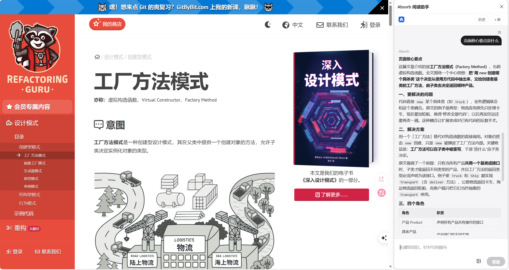
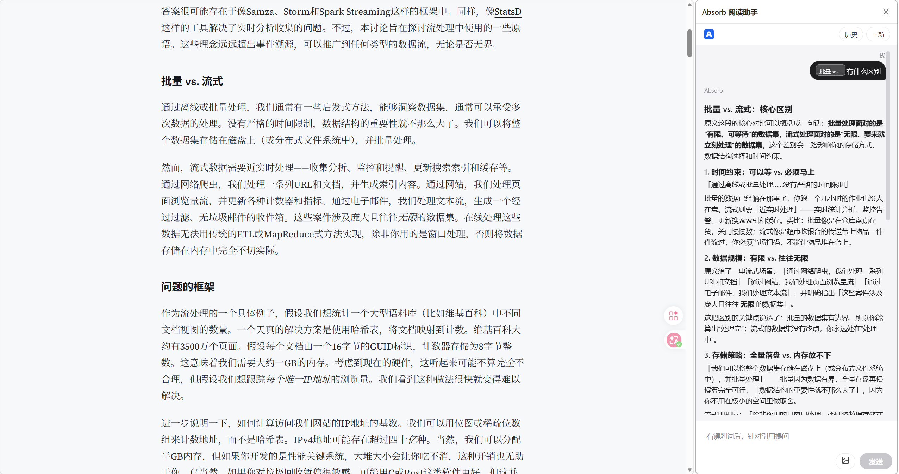
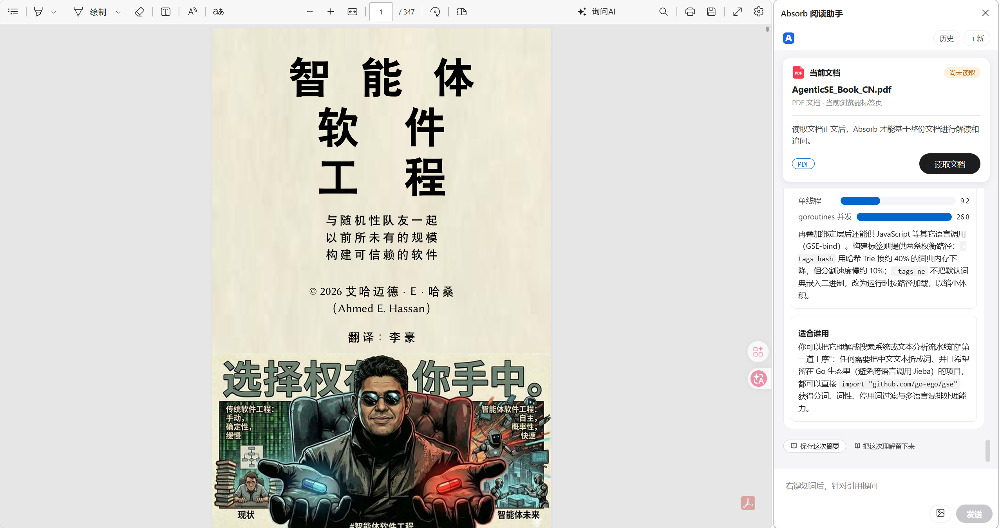
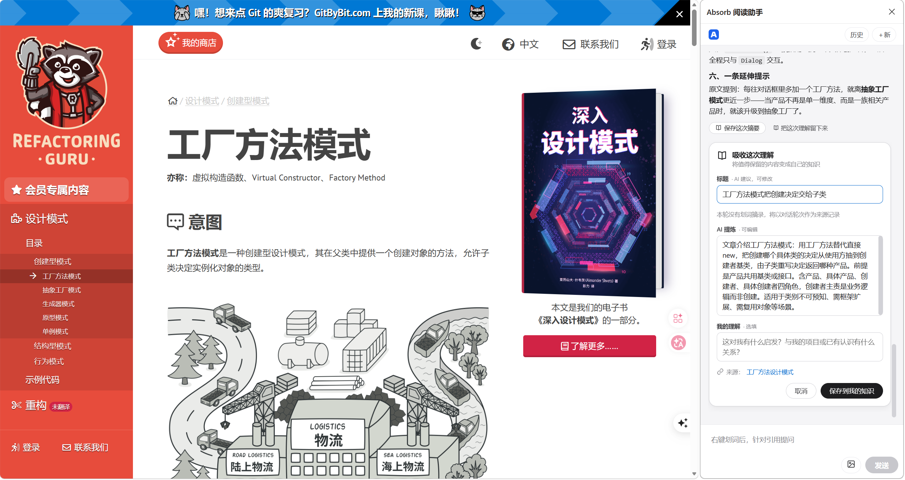

<p align="center">
  
</p>

<h1 align="center">Absorb Reading Assistant</h1>

<p align="center">
  <strong>Every read-through becomes the starting point for the next understanding.</strong><br>
  AI Reading Assistant · Personal Knowledge
</p>

<p align="center">
  <strong>English</strong> | <a href="README.zh-CN.md">中文</a>
</p>

<p align="center">
  <a href="LICENSE"></a>
  
  
</p>

---

Absorb is an AI reading assistant that helps you understand what you're reading and distill the understanding worth keeping into your own knowledge.

While reading an article, you can ask about a single sentence or discuss the whole piece with AI; for complex concepts and logic, let AI explain them with diagrams and visualizations. What's worth keeping can be saved together with the source evidence, the AI distillation, and your own thinking.

More importantly, that understanding doesn't vanish when the conversation ends. When you encounter related content again, your past understanding can take part in new thinking.

<p align="center">
  
</p>

## Why Absorb

We read a lot every day — articles, technical docs, reference material — and we constantly ask AI for explanations.

But a single read often leaves only a fleeting impression, and an AI conversation fades with time.

Bookmarks keep the links. Note apps keep the organized content. AI gives you the answer of the moment. Few tools actually care about:

- Why didn't I understand this passage back then?
- What conclusion did I form later?
- How does this reading connect to what I already knew?
- Did the new viewpoint change my earlier judgment?

What Absorb tries to solve is not how to save more information, but how to keep every understanding around — connected and reusable.

**Information can be bookmarked. Understanding needs to be absorbed.**

## From reading to personal knowledge

Absorb is built around a continuous loop:

### 1. Understand: it starts with a question

Select a sentence on any web page and ask Absorb directly. It reads the question together with its paragraph and the full page.

You can also skip the selection and discuss the whole article: follow up on claims, ask for examples, untangle the logic, or have it draw flowcharts and charts.

Reading stops being a one-way stream and becomes a conversation you can keep going deeper.

<p align="center">
  
</p>

PDF documents work the same way: once the document card extracts the text, you can ask about the whole document and keep following up.

<p align="center">
  
</p>

### 2. Absorb: keep what you truly understood

Not everything in a read is worth saving.

When you find a claim, conclusion, or explanation worth keeping, save it as your own knowledge record:

- **Source evidence**: the origin and key quotes.
- **AI distillation**: the core points, organized.
- **My understanding**: your own take, judgment, and additions.

The source provides the evidence, AI helps organize, and your own thinking is the part that truly belongs to you.

<p align="center">
  
</p>

### 3. Relate: let past understanding resurface

When you read related content again, Absorb can connect what you've accumulated before to what you're reading now.

You don't have to rely on memory alone, nor search your notes from scratch every time.

What you read, and what you concluded back then, can re-enter the current reading.

### 4. Update: let understanding evolve with new information

New content may reinforce a view — or supplement, even overturn it.

By placing old and new side by side, comparing viewpoints, and checking the original evidence, you can see how your understanding has changed.

Knowledge shouldn't just be a growing pile of records; it should be understanding that keeps getting better.

## How Absorb differs

| | Bookmarks | Note apps | Chat AI | Absorb |
|---|---|---|---|---|
| Main purpose | save sources | organize personal material | get instant explanations | understand and accumulate personal knowledge |
| Reading process | browse & bookmark | read & note | ask & answer | read, question, visualize |
| What is kept | links | notes | chat history | source evidence + AI distillation + personal understanding |
| Reused later? | reopen links | search notes yourself | dig through old chats | past understanding resurfaces and keeps the thinking going |

Absorb doesn't aim to replace your browser, note app, or chat AI — it wants to connect reading, understanding, and the accumulation of personal knowledge.

## When it fits

- Reading technical articles: understanding intricate principles, architecture and code logic.
- Reading long-form pieces: keep questioning the core argument instead of settling for a summary.
- Learning new concepts: build understanding with flowcharts, relationship diagrams and visual explanations.
- Reading opposing views: compare them against what you already believe.
- Learning a field over time: accumulate personal knowledge you can reuse and revise.

## Available today

| Capability | In one line | Status |
|---|---|---|
| **Step from a sentence into an article** | Where you stop is where understanding begins | Available |
| **One reading, one conversation** | Not a summarizer, but a partner you can question to the end | Available |
| **When it's hard to see, let it draw** | Flowcharts, charts, visual explanations — screenshots work too | Available |
| **Turn reading into owning** | The source is evidence, AI is distillation, **you are the judgment** | Available |
| **Read PDF documents** | Once the PDF text is extracted, ask and follow up on the whole document | Available |
| **Past understanding returns when it matters** | Brought back automatically; compare old and new in one click | Started |
| **Your knowledge doesn't belong to one model** | Nine model providers, switchable; keys and knowledge records stay on your machine, reading content is processed by the model provider you choose | Available |
| **It remembers where you've read** | Long-term memory, switchable at any time | Available |

## Milestones

| Milestone | What it covers | Status |
|---|---|---|
| **M1 · Reading you can trust** | Ask on a selection, talk to the whole page, keep following up — answers carry the selected sentence and the page's full text | Shipped |
| **M2 · Keeping the understanding** | Quote + AI distillation + your own words, saved as an editable record; whole-turn summaries in one click | Shipped |
| **M3 · Letting old understanding return** | When related content appears, a "Related to your past understanding" card, and one-click comparison | Partially available |
| **M4 · Evolving judgment** | Comparing old and new views, conflict hints, tracking how understanding changes | Planned |
| **M5 · Personal AI** | Trustworthy personal context assisting proposal writing and design reviews | Long-term |

A vision can be far; a promise has to be true.

## Getting started

1. **Install the desktop app** — download `absorb-agent-setup-<version>.exe` from [Releases](https://github.com/leijiadada/absorb/releases), run it, and follow the wizard. The installer registers the local service the extension needs, and optionally starts the app at login.
2. **Add a model key** — open the Models page on first launch and paste an API key from any provider (nine built in, including Zhipu, DeepSeek and Kimi). Once the Status page reports everything is normal, the service, extension and model are all ready.
3. **Install the browser extension** — use the install-extension guide on the Status page: download the extension folder and drag it into your browser's extensions page. No command line involved.
4. **Start reading** — select a sentence on any page and right-click "Ask Absorb"; or open the panel and ask about the whole page.

> Requirements: Windows 10/11 (WebView2), Chrome or Edge.
>
> No installer available yet? Build one yourself as described under For developers.

## For developers

Extension (Manifest V3) + desktop app (Wails / Go / Vue 3). Data lives in local SQLite, extension and desktop app talk over Native Messaging, and models go through OpenAI-compatible endpoints.

```bash
make run        # Build and launch the desktop app
make build      # Build the desktop app
make test       # Go unit tests + frontend / extension tests
make installer  # Generate the installer
```

The content extraction pipeline, project layout, test corpora and CI are documented in [CONTRIBUTING.md](CONTRIBUTING.md) (中文版：[CONTRIBUTING.zh-CN.md](CONTRIBUTING.zh-CN.md)).

## License

This project is open source under the [MIT License](LICENSE). Bundled third-party components follow their own licenses (MinGit — GPL-2.0; embedded Python — PSF License); see [runtime/README.md](runtime/README.md).

---

Last reviewed: 2026-11-14
