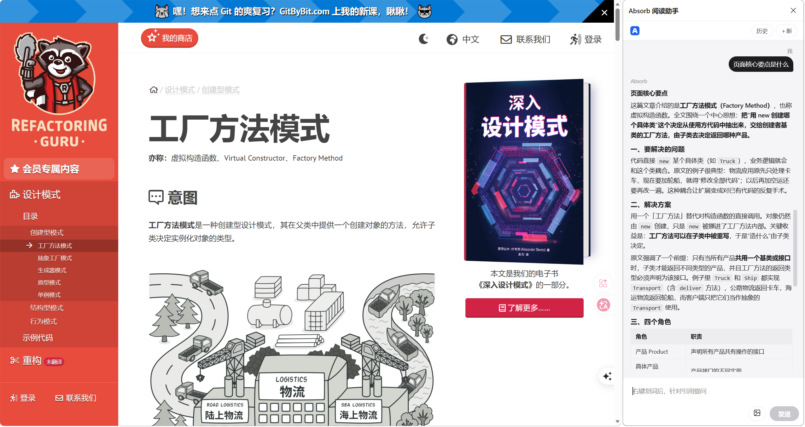
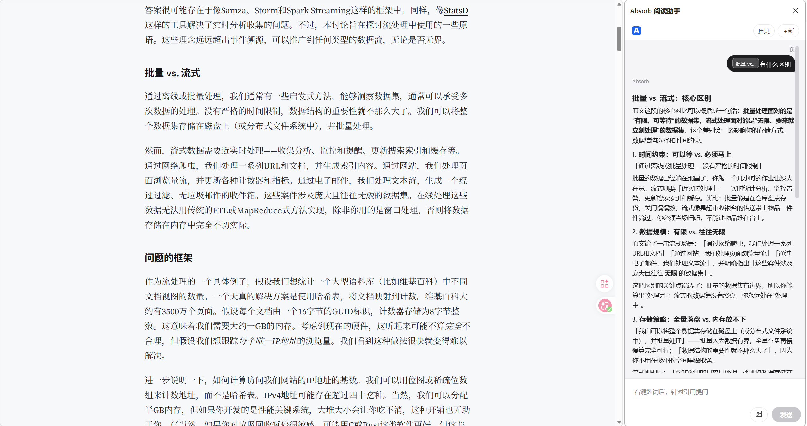
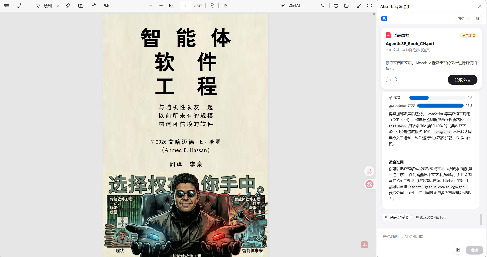
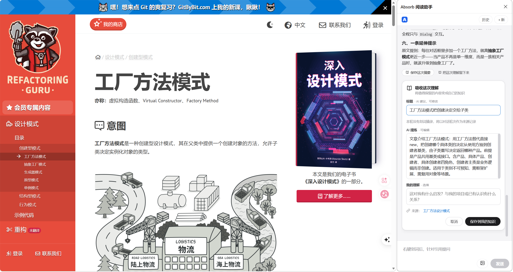

<p align="center">
  
</p>

<h1 align="center">Absorb 阅读助手</h1>

<p align="center">
  <strong>让每一次读懂，都成为下一次理解的起点。</strong><br>
  AI 阅读助手 · 个人知识
</p>

<p align="center">
  <a href="README.md">English</a> | <strong>中文</strong>
</p>

<p align="center">
  <a href="LICENSE"></a>
  
  
</p>

---

Absorb 是一款 AI 阅读助手，帮助你理解正在阅读的内容，并将有价值的理解沉淀为自己的知识。

阅读一篇文章时，你可以围绕某句话提问，也可以与 AI 讨论整篇内容；遇到复杂的概念和逻辑，让 AI 通过图表与可视化解释帮助你理解。值得留下的内容，可以连同原文证据、AI 提炼和自己的思考一起保存。

更重要的是，这些理解不会随着一次对话结束而消失。当你再次遇到相关内容，过去的认识可以重新参与新的思考。

<p align="center">
  
</p>

## 为什么需要 Absorb

我们每天阅读大量文章、技术文档和资料，也不断通过 AI 寻求解释。

但一次阅读往往只留下短暂的印象，一次 AI 对话也很容易随着时间被遗忘。

收藏夹留下了链接，笔记软件留下了整理后的内容，AI 给出了当下的问题答案，却很少有工具真正关注：

- 我当时为什么不理解这段内容？
- 后来我形成了什么认识？
- 这次阅读与过去的认识有什么联系？
- 新的观点是否改变了我原来的判断？

Absorb 希望解决的不是如何保存更多信息，而是如何让每一次理解都能被保留、关联和继续使用。

**信息可以被收藏，理解需要被吸收。**

## 从阅读到个人知识

Absorb 围绕一个持续循环展开：

### 1. 理解：从疑问开始

在网页中选中一句话，直接向 Absorb 提问。它会结合所在段落和当前页面内容理解你的问题。

你也可以不选中文本，直接与 AI 讨论整篇文章，追问观点、要求举例、梳理逻辑，或者生成流程图和数据图表。

阅读不再只是获取信息，而是一次可以持续深入的交流。

<p align="center">
  
</p>

PDF 文档同样适用：打开文档卡读取正文后，可以基于整份文档提问与追问。

<p align="center">
  
</p>

### 2. 吸收：留下真正理解的内容

一次阅读中，并不是所有内容都值得保存。

当你发现某个观点、结论或解释值得留下，可以将它保存为自己的知识记录：

- **原文证据**：保留来源与关键摘录。
- **AI 提炼**：整理核心观点和重要信息。
- **我的理解**：记录自己的认识、判断和补充。

原文负责提供依据，AI 帮助整理，你的思考才是知识真正属于你的部分。

<p align="center">
  
</p>

### 3. 关联：让过去的理解重新出现

当你再次阅读相关内容，Absorb 可以将过去积累的理解与当前内容建立联系。

你不必完全依赖记忆，也不必总是从头搜索过去的笔记。

过去读过什么、当时形成了什么认识，都有机会重新进入当前的阅读过程。

### 4. 更新：让认识随着新信息不断变化

新内容可能强化已有观点，也可能补充甚至推翻过去的认识。

通过并置新旧内容、比较不同观点和查看原文依据，你可以发现自己的认识发生了什么变化。

知识不应该只是越来越多的记录，而应该是不断得到完善的理解。

## Absorb 有什么不同

| | 收藏夹 | 笔记软件 | 通用 AI | Absorb |
|---|---|---|---|---|
| 主要用途 | 保存信息来源 | 整理个人资料 | 获取即时解释 | 理解并积累个人知识 |
| 阅读过程 | 浏览与收藏 | 阅读与记录 | 提问与回答 | 阅读、提问、可视化解释 |
| 知识沉淀 | 链接 | 笔记 | 对话记录 | 原文证据 + AI 提炼 + 个人理解 |
| 后续利用 | 重新打开链接 | 主动查找笔记 | 翻找历史对话 | 关联过去的认识，继续思考 |

Absorb 不是要取代你的浏览器、笔记软件或通用 AI，而是希望把阅读、理解和个人知识积累连接起来。

## 适合怎样使用

- 阅读技术文章时，理解复杂的技术原理、架构和代码逻辑。
- 阅读长篇文章时，围绕核心论点持续追问，而不是只看一份摘要。
- 学习新概念时，通过流程图、关系图和可视化解释建立认知。
- 阅读不同观点时，将它们与过去的理解进行比较。
- 长期学习某个领域时，逐渐积累可以反复利用和修正的个人知识。

## 今天就能用

| 能力 | 一句话 | 状态 |
|---|---|---|
| **从一句话进入一篇文章** | 你在哪一句停下，理解就从哪一句开始 | 已可用 |
| **一次阅读，一场对话** | 不是摘要工具，是可以追问到底的阅读搭档 | 已可用 |
| **看不懂的地方，让它画出来** | 流程图、图表、可视化解释；也可以直接截图提问 | 已可用 |
| **把读懂，变成拥有** | 原文是证据，AI 是提炼，**你是判断** | 已可用 |
| **解读 PDF 文档** | 读取 PDF 正文后，基于整份文档提问与追问 | 已可用 |
| **旧理解，会在新问题出现时回来** | 相关内容出现时自动带回，可一键比较新旧 | 已起步 |
| **你的知识不属于某一个模型** | 九家模型服务可切换；密钥与个人知识记录保存在本机，阅读内容按所选模型服务商处理 | 已可用 |
| **它记得你读到过哪里** | 长期记忆可随时关闭 | 已可用 |

## 里程碑

| 里程碑 | 内容 | 状态 |
|---|---|---|
| **M1 · 可靠的阅读** | 划词提问、整页对话、多轮追问，回答自带选中句与全文上下文 | 已上线 |
| **M2 · 把理解留下来** | 原文摘录 + AI 提炼 + 我的理解，存成可编辑的知识记录；整轮摘要可一键留存 | 已上线 |
| **M3 · 让旧理解回来** | 读到相关内容时提示「与你之前的理解有关」，一键比较新旧 | 部分可用 |
| **M4 · 认知演化** | 新旧观点对比、冲突提示、理解变化的追踪 | 规划中 |
| **M5 · 个人 AI** | 以可信的个人上下文，辅助方案写作与技术评审 | 远期 |

愿景可以很远，承诺必须是真的。

## 开始使用

1. **安装桌面端** —— 下载 `absorb-agent-setup-<版本>.exe`（[Releases](https://github.com/leijiadada/absorb/releases)），双击运行，按向导完成安装。安装程序会自动注册浏览器扩展所需的本地服务，并可选开机自启。国内访问可改用 [Gitee Releases](https://gitee.com/leij1/absorb/releases)。
2. **填入模型密钥** —— 首次启动后打开「模型」页，粘贴任意一家服务商的 API 密钥（内置智谱、DeepSeek、Kimi 等九家）。「状态」页显示「一切正常」，说明服务、扩展、模型都已就绪。
3. **安装浏览器扩展** —— 在「状态」页点「安装扩展」，按弹窗提示下载扩展文件夹，拖入浏览器的扩展管理页即可，全程不需要命令行。
4. **开始阅读** —— 在任意网页选中一句话，右键「Absorb 解读」；或者直接打开面板，对整页内容提问。

> 系统要求：Windows 10 / 11（需 WebView2）、Chrome 或 Edge。
>
> 暂时没有安装包？可按下文「开发者」一节自行构建。

## 开发者

扩展（Manifest V3）+ 桌面端（Wails / Go / Vue 3）。数据存在本机 SQLite，扩展与桌面端经 Native Messaging 通信，模型走 OpenAI 兼容接口。

```bash
make run        # 构建并启动桌面端
make build      # 构建桌面端产物
make test       # Go 单元测试 + 前端 / 扩展测试
make installer  # 生成安装程序
```

内容提取链路、目录结构、测试语料与 CI 说明见 [CONTRIBUTING.zh-CN.md](CONTRIBUTING.zh-CN.md)（English: [CONTRIBUTING.md](CONTRIBUTING.md)）。

## License

本项目基于 [MIT License](LICENSE) 开源。随包分发的第三方组件遵循其自身许可证（MinGit — GPL-2.0；嵌入式 Python — PSF License），详见 [runtime/README.md](runtime/README.md)。

---

最后审阅：2026-11-14
