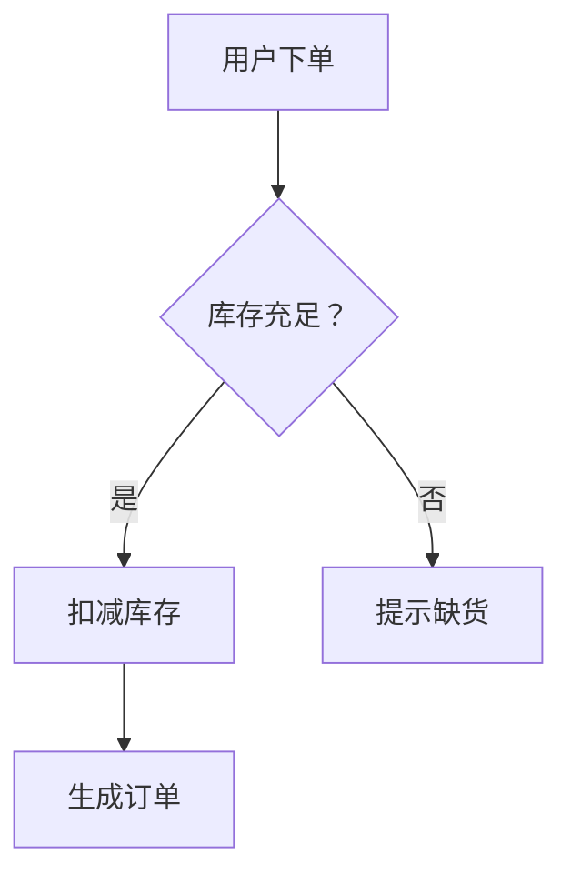
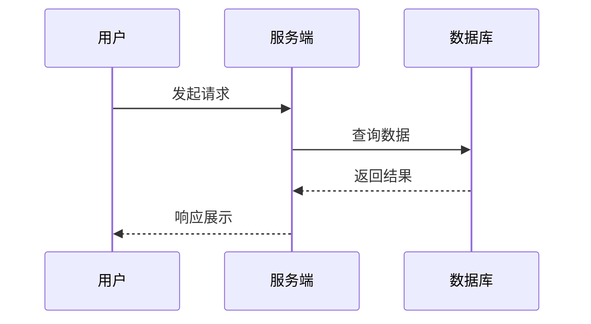
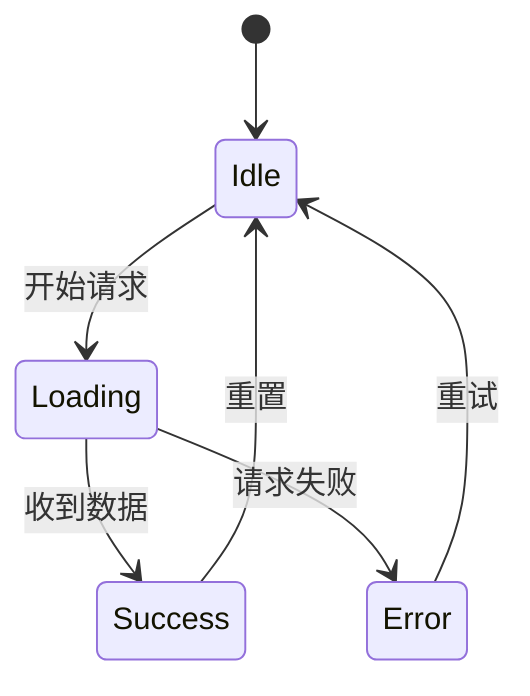
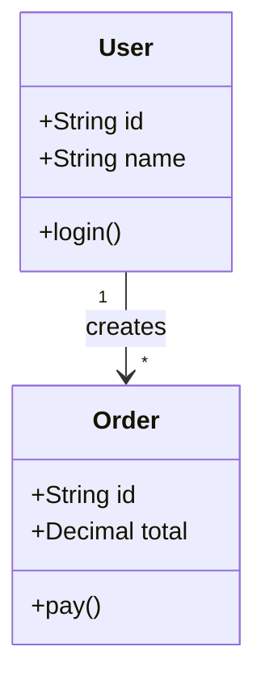
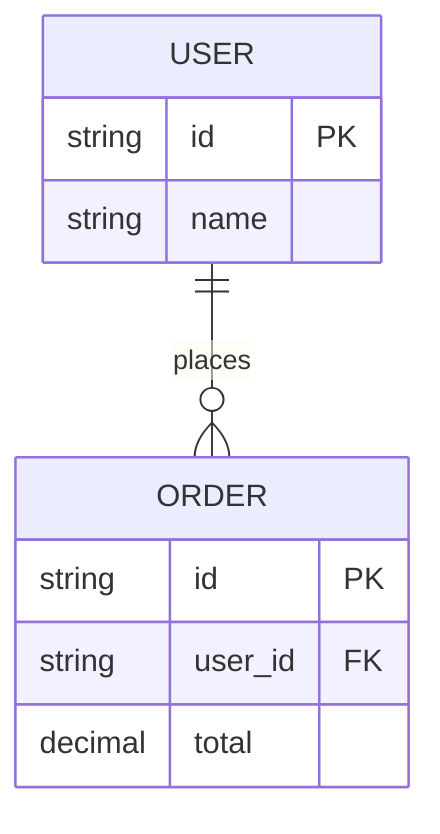

# Mermaid 图表规范

把要表达的结构写成 ```mermaid 代码块直接输出在回复里（不要写文件、不要生成 HTML），面板会自动渲染成图。

## 语法红线（必须全部遵守）

1. 只用这 5 种图：flowchart、sequenceDiagram、stateDiagram-v2、classDiagram、erDiagram。不用 pie/gantt/mindmap 等。
2. 节点与边的文字一律用英文双引号包裹：`A["下单"] -->|"成功"| B["发货"]`；文字内不要出现英文双引号本身，引号语义用「」。
3. 节点 id 只用英文字母/数字（如 A、order、db1）；一行一条语句，缩进统一 4 空格。
4. 从下方模板改字生成：只替换节点 id、文字、连线关系，不要自创语法（style/classDef/subgraph 仅在模板出现时使用）。
5. 输出前自查：括号/方括号成对、箭头方向正确、participant/实体先声明后使用。
6. 图保持 3~10 个节点，过大拆成多图。

## 模板（复制后改字）

### flowchart（流程/架构）



### sequenceDiagram（交互时序）



### stateDiagram-v2（状态转换）



### classDiagram（类/模块关系）



### erDiagram（数据实体关系）



## 选择指引

- 步骤/分支/架构分层 → flowchart；多方消息交互 → sequenceDiagram；生命周期/状态机 → stateDiagram-v2；代码结构 → classDiagram；表/存储关系 → erDiagram。
- 中文标签必须引号包裹；同一图内连线关系表达主要逻辑，次要细节用文字补充说明。
